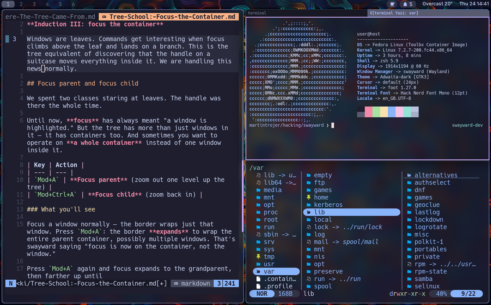

<p align="center"></p>

# swayward

**An i3/sway-compatible Wayland compositor, built in Rust on Smithay.**

> sway, gone its own way.

swayward brings i3's fully nested container tree to a modern Wayland
compositor: splits inside splits, tabbed and stacked containers, marks,
criteria, the scratchpad, and sway's IPC protocol on `SWAYSOCK`.

Your sway tools keep working. The tested parts of Waybar's sway modules,
`swaymsg`, i3ipc-python, autotiling, Quickshell's I3 model, and
DankMaterialShell run unmodified, and the
[client coverage matrix](docs/SWAY_IPC_ECOSYSTEM.md) says exactly what each
probe exercises.

**Status: beta.** swayward is the maintainer's daily driver on two work
machines, both Fedora 44: one a single monitor with Waybar and kanshi, the
other two monitors running DankMaterialShell with its outputs set in
`config.kdl`. It is a compositor, so a crash takes your whole session.



A `splitv` inside a tabbed container inside a `splith`, with Waybar across the
top. [Cult of the Tree](https://github.com/swayward-wm/swayward/wiki/Sway-School)
pairs more captures with the tree each one produced.

## How compatibility is measured

swayward is measured against sway 1.12 by the separate [sway IPC
oracle](https://github.com/swayward-wm/sway-ipc-oracle), using the same
black-box runners that record sway itself. Anyone can rerun it from a clean
checkout.

<!-- i3-suite-summary:sway-compat generated from the pinned oracle; do not edit by hand -->
Swayward snapshot `swayward-1fd3c25b` against sway 1.12, from oracle [`27560327`](https://github.com/swayward-wm/sway-ipc-oracle/tree/27560327227afd9ff05ea40f3c527b7333e714a6).

| Sway-compatibility corpus (reference: sway 1.12) | Match | Mismatch |
|---|---:|---:|
| Hand-picked state scenarios | 4,908 | 9 |
| Event streams | 45 | 0 |
| States reached by i3's test sequences | 4,148 | 12 |
| Random 20-step sequences | 466 | 34 |
| Malformed commands | 195 | 0 |
| Broken IPC framing | 6 | 4 |
<!-- end i3-suite-summary:sway-compat -->

The oracle lists every mismatch with its reason. A random sequence records
only its first difference, so one difference marks the whole run. The framing
mismatches are deliberate: swayward disconnects or replies with an error where
sway waits.

The rest of the test machinery, all described in [Testing and
conformance](https://github.com/swayward-wm/swayward/wiki/Testing-and-Conformance):

- **i3's own test suite runs unchanged**, through the oracle and inside
  swayward's test process, where its fully green files gate every push. Sway has no conformance suite, so
  i3's supplies many of the scenarios above; [I3 suite
  results](docs/I3_SUITE_RESULTS.md) explains which assertions need X11 or i3
  internals.
- **A randomized layout suite runs on every push**, in release mode, checking
  the tree's invariants after every operation.
- **A nightly live IPC soak** drives a release build with command fuzz, wire
  fuzz, and random commands with output hotplug. Every request must get a
  reply, and the log must stay free of `ERROR` and panics.
- **The oracle is published for other compositors.** Its
  [results page](https://github.com/swayward-wm/sway-ipc-oracle/blob/main/docs/results.md)
  measures i3, sway, and other sway-IPC compositors with the same rules.

## Looking for beta testers

**Are you tree-curious, or a seasoned tree surgeon?** Either way, your help is
welcome.

The most useful things to try: run your real sway or i3 config through
[`contrib/sway-to-kdl`](contrib/sway-to-kdl); tell us where swayward differs
from sway in a way that matters to you, especially anything not already
[explained](https://github.com/swayward-wm/swayward/wiki/Differences-from-Sway);
break the tree with deeply nested splits and awkwardly timed scratchpad calls;
and tell us where the docs were confusing.

[Open an issue](https://github.com/swayward-wm/swayward/issues) with what you
ran, what happened, and what you expected. A vague "this felt wrong" is worth
more than silence.

## Why the i3/sway model

This is a good era for Wayland compositors. niri's scrollable strip is a new
idea, built well, and swayward owes it nearly everything below the layout
engine. Hyprland has pushed hardest on effects. sway did the unglamorous work
of being the compositor people rely on, and i3 contributed the tree itself.

We think that tree is the right model for window management:

- **It is what you already mean.** Every layout is a nesting of "these share
  space horizontally" and "these share space vertically".
- **It composes without limit.** A container holds windows or other
  containers, so tabs inside a split inside a tab cost nothing extra to learn.
- **It is explicit, and it remembers.** swayward does not guess where your next
  window goes. The arrangement is a structure you built, not a side effect of
  the order you opened things in.

[Cult of the Tree](https://github.com/swayward-wm/swayward/wiki/Sway-School)
teaches the model from first principles, and
[who planted the tree](https://github.com/swayward-wm/swayward/wiki/Who-Planted-The-Tree)
traces it back through wmii to Plan 9. The
[FAQ](https://github.com/swayward-wm/swayward/wiki/FAQ#why-does-swayward-exist)
covers why swayward exists alongside sway, SwayFX, hy3, and niri.

If the scrollable strip suits you better, use
[niri](https://github.com/YaLTeR/niri). It is excellent, it is where swayward
came from, and swayward deliberately does not offer a scrollable mode.

## Install

There is no public build yet. For now, install the current source with Nix or
[build swayward](docs/BUILDING.md). The first beta will put these prebuilt
x86_64 packages on the [release page](https://github.com/swayward-wm/swayward/releases):

| File | For |
|---|---|
| `swayward_VERSION_amd64.deb` | Ubuntu 24.04 |
| `swayward-VERSION-fedora43-x86_64.rpm` | Fedora 43 |
| `swayward-VERSION-fedora44-x86_64.rpm` | Fedora 44 |
| `swayward-VERSION-arch-x86_64.pkg.tar.zst` | Arch |
| `swayward-VERSION-ubuntu24.04-x86_64.tar.gz` | prebuilt binaries, with a `.sha256` |

The release workflow installs and executes every package in a clean container
before it drafts the release. The tarball is an Ubuntu 24.04 build needing
GLIBC 2.39 and `libdisplay-info.so.1`, not a generic Linux build. See [Getting
started](https://github.com/swayward-wm/swayward/wiki/Getting-Started) for the
install commands once beta 1 is published.

There is no COPR repository or AUR package. Both wait until the release packages
have survived real installations.

To install the current source with Nix:

```sh
nix profile install github:swayward-wm/swayward
```

The repository flake provides `swayward`, `swayward-debug`, and a development
shell. `nix flake check` builds both and runs the tests that work in the Nix
sandbox; tests that need the fetched oracle or an EGL display run in CI.
Without Nix, follow [Build swayward](docs/BUILDING.md); it needs Rust 1.87 or newer and the usual
wlroots-style build dependencies.

## First run

With a package installed, pick **Swayward** from your display manager. To try
it without leaving your current session, run it nested in a window:

```sh
swayward
```

From a source checkout, `contrib/dev-run.sh --release` builds and starts a
nested session, and `contrib/install-session.sh` adds a **Swayward (dev)**
entry to your display manager. The
[getting-started guide](https://github.com/swayward-wm/swayward/wiki/Getting-Started)
covers both.

The defaults give you a working session: `Mod` is Super (Alt when running
nested, so your outer session keeps its Super keys), `Mod+Return` opens a
terminal, `Mod+D` runs a launcher, `Mod+Shift+Q` closes a window, and
`Mod+Shift+E` exits. The full set is in
[resources/default-config.kdl](resources/default-config.kdl), and the
[getting-started guide](https://github.com/swayward-wm/swayward/wiki/Getting-Started) walks through it.

Press `Mod+Shift+Slash` at any time for the hotkey overlay.

## Using it

Swayward exports `SWAYSOCK` and speaks sway's binary IPC, so the tools you
already have work:

```sh
swaywardmsg -t get_tree
swaywardmsg -t get_workspaces -p
swaywardmsg 'workspace 3'
swaywardmsg -t subscribe -m '["window"]'
```

`swaywardmsg` ships with swayward, so you do not need sway installed to drive
the socket. `swaymsg` works too if you have it.

### Screen sharing and portals

Swayward defaults to `xdg-desktop-portal-gnome`, which gives you the GNOME
window and monitor picker, PipeWire streams and a dynamic cast target. This is
a deliberate difference from sway, which conventionally uses
`xdg-desktop-portal-wlr`. Remote desktop and input injection are not
implemented.

Portals need a full swayward session and a few packages installed; see
[Important software](https://github.com/swayward-wm/swayward/wiki/Important-Software).

Waybar 0.15.0 has been smoke-tested unmodified. Mako, swaybg, swayidle and
swaylock use standard Wayland protocols rather than sway IPC. Scripts work to
the extent they stay inside the implemented surface, and the
[sway compatibility guide](https://github.com/swayward-wm/swayward/wiki/Sway-Compatibility) explains the
boundary.

### Configuration

Swayward is **IPC-compatible, not config-compatible**. It is configured in
typed KDL, which is what lets it carry niri's animation and rendering settings
without inventing a second config language.

Bring an existing sway config across with the translator, which ships with
swayward:

```sh
swayward-sway-to-kdl ~/.config/sway/config >~/.config/swayward/config.kdl
swayward validate -c ~/.config/swayward/config.kdl
```

It reports what it cannot translate exactly instead of quietly dropping it.
See [Migrate a sway config](docs/SWAY_CONFIG_MIGRATION.md).

## What differs from sway

Read [differences from sway](https://github.com/swayward-wm/swayward/wiki/Differences-from-Sway)
before migrating. The headlines:

- **X11 identity is flattened.** Xwayland goes through
  `xwayland-satellite`, which presents ordinary `xdg_toplevel` surfaces, so
  separate X11 class, instance, role and XID do not cross the boundary.
- **No `bar {}` block.** swayward does not launch or configure swaybar.
  Configure Waybar directly.
- **No in-place restart.** Reload is supported; replacing the process while
  keeping clients is not. Sway has no runtime `restart` either.
- **The IPC surface is incomplete.** Some requests, events, criteria and
  command forms are unimplemented and return structured failures rather than
  pretending to succeed.

Every intentional difference is recorded with a citation into sway's source.

## Developed with AI assistance

swayward was built largely with AI assistance. A human reviews every change
and is responsible for it, following the Linux kernel's rule that
[AI does not sign off](https://www.kernel.org/doc/html/next/process/coding-assistants.html).
Much of that effort went into the test machinery described above.

## Project invariants

- Every `SWAYSOCK` reply is sway-shaped or a structured failure. It never hangs.
- The container tree stays well formed after every mutation.
- A live-session path must not panic, and an `ERROR` in the log is a bug.
- A feature needs executable evidence before it counts as working.
- Stability regressions outrank new features.

## Credits

swayward is a fork of niri at commit `9e72e491`, which is why the repository
carries niri's long history and contributors. It keeps niri's rendering,
backend, protocol and portal work. See [Fork base](docs/FORK-BASE.md).

- [niri](https://github.com/YaLTeR/niri) by Ivan Molodetskikh: the compositor
  this is built on. The debt is large and gladly acknowledged.
- [Smithay](https://github.com/Smithay/smithay): the Wayland compositor
  toolkit underneath.
- [sway](https://github.com/swaywm/sway): the IPC protocol, and the standard
  of reliability worth aiming at.
- [i3](https://i3wm.org): the tree model, and the conformance suite that keeps
  us honest about it.

Licensed under **GPL-3.0-or-later**. The i3 tests in
[sway-ipc-oracle](https://github.com/swayward-wm/sway-ipc-oracle) keep their
upstream BSD licence.
