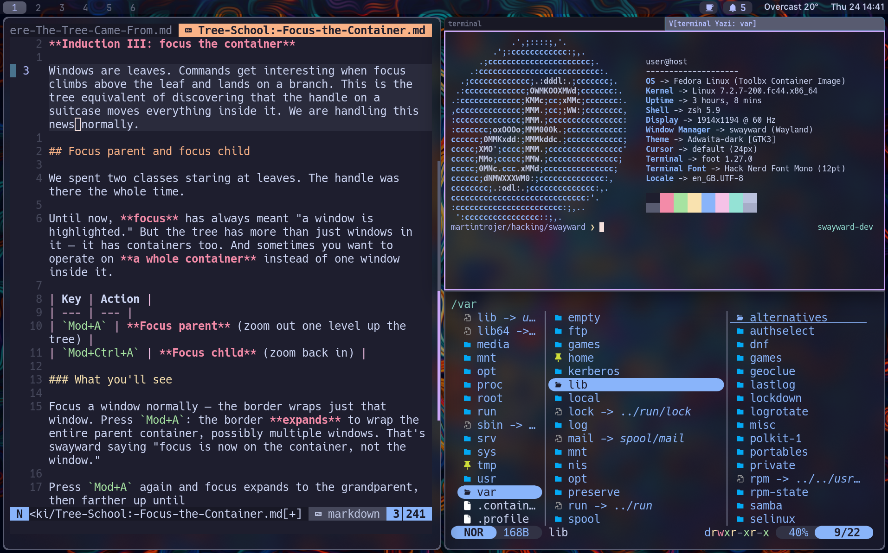

<p align="center"></p>

# swayward

An i3/sway-compatible tiling Wayland compositor, built in Rust on Smithay.

swayward is a fork of [niri](https://github.com/YaLTeR/niri) that keeps niri's
rendering, backend, protocol, and portal code, and replaces the scrollable
strip with i3's nested container tree: splits inside splits, tabbed and stacked
containers, marks, criteria, the scratchpad, and sway's IPC protocol on
`SWAYSOCK`.

Waybar's sway modules, `swaymsg`, i3ipc-python, autotiling, Quickshell's I3
model, and DankMaterialShell work unmodified for the surfaces tested in the
[client coverage matrix](docs/SWAY_IPC_ECOSYSTEM.md).

Status: beta. Daily-driven on Fedora 45 (single-monitor with Waybar and kanshi,
and dual-monitor with DankMaterialShell and Noctalia 5), and on a multi-monitor
setup by a contributor. It is a compositor, so a crash takes your session.



A `splitv` inside a tabbed container inside a `splith`, with Waybar across the
top. See [Cult of the Tree](https://github.com/swayward-wm/swayward/wiki/Sway-School)
for more examples, [who planted the tree](https://github.com/swayward-wm/swayward/wiki/Who-Planted-The-Tree)
for the history, and the [FAQ](https://github.com/swayward-wm/swayward/wiki/FAQ#why-does-swayward-exist)
for how swayward fits alongside sway, SwayFX, hy3, and niri. If you want a
scrollable strip, use [niri](https://github.com/YaLTeR/niri) — swayward does
not offer a scrollable mode.

## How compatibility is measured

swayward is measured against sway 1.12 by the separate
[sway IPC oracle](https://github.com/swayward-wm/sway-ipc-oracle), using the
same black-box runners that record sway itself. Anyone can rerun it from a
clean checkout.

<!-- i3-suite-summary:sway-compat generated from the pinned oracle; do not edit by hand -->
Swayward snapshot `swayward-fc39ac88` against sway 1.12, from oracle [`92945a6e`](https://github.com/swayward-wm/sway-ipc-oracle/tree/92945a6ea5137be392f0db677b45b822c9bb505b).

| Sway-compatibility corpus (reference: sway 1.12) | Match | Mismatch | Unstable |
|---|---:|---:|---:|
| Hand-picked state scenarios | 4,970 | 17 | 0 |
| Event streams | 45 | 0 | 0 |
| States reached by i3's test sequences | 4,151 | 9 | 0 |
| Random 20-step sequences | 466 | 33 | 1 |
| Malformed commands | 195 | 0 | 0 |
| Broken IPC framing | 6 | 4 | 0 |
<!-- end i3-suite-summary:sway-compat -->

The oracle lists every mismatch with its reason. A random sequence records only
its first difference, so one difference marks the whole run. The framing
mismatches are deliberate: swayward disconnects or returns an error where sway
waits.

Other checks (details in
[Testing and conformance](https://github.com/swayward-wm/swayward/wiki/Testing-and-Conformance)):

- i3's own test suite runs unchanged through the oracle and in CI, where its
  green files gate every push ([i3 suite results](docs/I3_SUITE_RESULTS.md)).
- A randomized layout property suite runs on every push in release mode,
  checking tree invariants after every operation.
- A nightly live IPC soak drives a release build with command fuzz, wire fuzz,
  and random commands with output hotplug; every request must get a reply and
  the log must stay free of `ERROR` and panics.
- The oracle's [results page](https://github.com/swayward-wm/sway-ipc-oracle/blob/main/docs/results.md)
  measures i3, sway, and other sway-IPC compositors under the same rules.

## Beta feedback

If you try it, the most helpful reports are: running your sway or i3 config
through [`contrib/sway-to-kdl`](contrib/sway-to-kdl), differences from sway not
already listed in
[Differences from sway](https://github.com/swayward-wm/swayward/wiki/Differences-from-Sway),
edge cases with deeply nested splits or scratchpad timing, and confusing docs.
[Open an issue](https://github.com/swayward-wm/swayward/issues) with what you
ran, what happened, and what you expected.

## Install

Prebuilt x86_64 packages are on the
[release page](https://github.com/swayward-wm/swayward/releases):

| File | For |
|---|---|
| `swayward_VERSION_amd64.deb` | Ubuntu 24.04 |
| `swayward-VERSION-fedora44-x86_64.rpm` | Fedora 44 |
| `swayward-VERSION-fedora45-x86_64.rpm` | Fedora 45 |
| `swayward-VERSION-arch-x86_64.pkg.tar.zst` | Arch |
| `swayward-VERSION-ubuntu24.04-x86_64.tar.gz` | prebuilt binaries, with a `.sha256` |

Each package is installed and executed in a clean container before release. The
tarball targets Ubuntu 24.04 (GLIBC 2.39 and `libdisplay-info.so.1`). See
[Getting started](https://github.com/swayward-wm/swayward/wiki/Getting-Started)
for install commands. There is no COPR or AUR package yet.

Use a `swayward-v*` release tag or a `release/YY.MM` branch (such as
`release/26.10`); `main` is the development branch
([Release lifecycle](docs/UPSTREAM.md#release-lifecycle)).

With Nix, where `VERSION` is the release version:

```sh
nix profile install github:swayward-wm/swayward/swayward-vVERSION
```

The flake provides `swayward`, `swayward-debug`, and a dev shell
(`nix flake check` runs the tests that work in the Nix sandbox). Without Nix, see
[Build swayward](docs/BUILDING.md) (needs Rust 1.87+ and standard Wayland
compositor build dependencies).

## First run

Pick **Swayward** from your display manager, or run it nested in a window:

```sh
swayward
```

From a source checkout, `contrib/dev-run.sh --release` starts a nested session
and `contrib/install-session.sh` installs a **Swayward (dev)** display-manager
entry ([Getting started](https://github.com/swayward-wm/swayward/wiki/Getting-Started)).

Defaults: `Mod` is Super (Alt when nested), `Mod+Return` opens a terminal,
`Mod+D` runs a launcher, `Mod+Shift+Q` closes a window, `Mod+Shift+E` exits,
and `Mod+Shift+Slash` shows the hotkey overlay. The full default config is in
[resources/default-config.kdl](resources/default-config.kdl).

## Using it

swayward exports `SWAYSOCK` and speaks sway's binary IPC:

```sh
swaywardmsg -t get_tree
swaywardmsg -t get_workspaces -p
swaywardmsg 'workspace 3'
swaywardmsg -t subscribe -m '["window"]'
```

`swaywardmsg` ships with swayward; `swaymsg` works too if installed.

### Screen sharing and portals

swayward defaults to `xdg-desktop-portal-gnome` (GNOME window/monitor picker,
PipeWire streams, dynamic cast target) rather than `xdg-desktop-portal-wlr`.
Remote desktop and input injection are not implemented. See
[Important software](https://github.com/swayward-wm/swayward/wiki/Important-Software)
for required packages.

Waybar 0.15.0 is smoke-tested unmodified. Mako, swaybg, swayidle, and swaylock
use standard Wayland protocols. See
[Sway compatibility](https://github.com/swayward-wm/swayward/wiki/Sway-Compatibility)
for IPC script boundaries.

### Configuration

swayward is IPC-compatible with sway, not config-compatible. It uses typed KDL
so it can keep niri's animation and rendering settings.

Translate an existing sway config with the bundled converter:

```sh
swayward-sway-to-kdl ~/.config/sway/config >~/.config/swayward/config.kdl
swayward validate -c ~/.config/swayward/config.kdl
```

Unsupported directives are reported instead of silently dropped. See
[Migrate a sway config](docs/SWAY_CONFIG_MIGRATION.md).

## What differs from sway

See [Differences from sway](https://github.com/swayward-wm/swayward/wiki/Differences-from-Sway)
for the full list with citations into sway's source. The main differences:

- X11 identity is flattened: Xwayland runs through `xwayland-satellite`, which
  presents ordinary `xdg_toplevel` surfaces, so separate X11 class, instance,
  role, and XID do not cross the boundary.
- No `bar {}` block: configure Waybar directly.
- No in-place restart: config reload works; replacing the process while keeping
  clients does not (sway has no runtime `restart` either).
- Incomplete IPC surface: unimplemented requests, events, criteria, and command
  forms return structured failures rather than pretending to succeed.

## Developed with AI assistance

swayward was built largely with AI assistance. A human reviews every change and
is responsible for it, following the Linux kernel's rule that
[AI does not sign off](https://www.kernel.org/doc/html/next/process/coding-assistants.html).
Much of that effort went into the test machinery described above.

## Credits

swayward is forked from niri at commit `9e72e491` and keeps its git history
([Fork base](docs/FORK-BASE.md)).

- [niri](https://github.com/YaLTeR/niri) by Ivan Molodetskikh: the compositor
  this is built on.
- [Smithay](https://github.com/Smithay/smithay): the Wayland compositor toolkit
  underneath.
- [sway](https://github.com/swaywm/sway): the IPC protocol and reference
  behaviour.
- [i3](https://i3wm.org): the tree model and conformance suite.

Licensed under GPL-3.0-or-later. The i3 tests in
[sway-ipc-oracle](https://github.com/swayward-wm/sway-ipc-oracle) keep their
upstream BSD licence. Code ported from sway carries sway's MIT notice in
[`THIRD-PARTY.md`](THIRD-PARTY.md).
